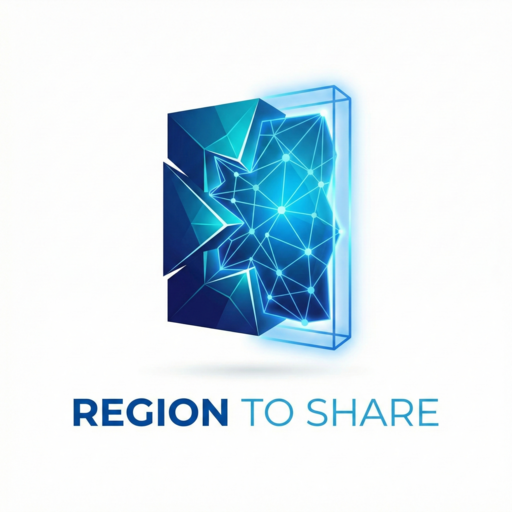

# Region to Share v3.0

<p align="center">
  
</p>

**Share, record live, or stream any region of your screen** — Native Rust suite for Linux (Wayland & X11) with KDE Plasma 6 Plasmoid, GNOME Shell Extension, PipeWire Virtual Camera, and cross-platform foundations for macOS & Windows.

[](https://opensource.org/licenses/MIT)

## What's New in v3.0 ("Full Capa")

- **Sleek Modern Design System** — Dark/Light theme synced automatically with your OS, crisp vector icons, Inter/Mono typography, 3-card QuickHub, and saved 1-click **Region Presets**.
- **Pro Spotlight Region Selector** — Inverted dark scrim (bright, clear interior), 8 resize handles + keyboard pixel nudging, aspect-ratio locking (`16:9`, `16:10`, `4:3`, `1:1`, `9:16`, `21:9`), 4× magnifier loupe, and floating action pill (`Share`, `Record`, `Virtual Cam`, `Snapshot`, `Save Preset`).
- **100% Pure Mirror Window + Detached Mini-HUD** — Zero buttons overlaid on the shared video stream; controls live in a separate compact floating pill or in your KDE/GNOME top/bottom panel.
- **First-Class Wayland Support** — Persisted XDG ScreenCast `restore_token` (no repeated permission prompts), **KDE Plasma 6 Native Portal Direct Mode** (`zkde_screencast_unstable_v1::stream_region` with zero double-selection), in-callback PipeWire cropping with `SharedBufferPool`, and ultrawide 5K/8K support.
- **Live Crash-Safe Recording (GUI + CLI)** — Continuous streaming writes to **MKV**, **Fragmented MP4**, **WebM**, **GIF**, `stdout` pipes, or `rtmp://`/`srt://`, with automatic **VA-API / NVENC / VideoToolbox / CPU** hardware encoder selection and optional desktop/microphone audio.
- **PipeWire Virtual Camera** — Publish any screen region directly as a native `Video/Source` camera in Chrome, Firefox, Google Meet, Discord, Zoom, and OBS without `v4l2loopback`.
- **Native Desktop Components** — Official **KDE Plasma 6 Plasmoid** (`org.kde.plasma.regiontoshare`) and **GNOME Shell Extension** (`region-to-share@solarpush.github.io`) communicating asynchronously over D-Bus (`io.github.solarpush.RegionToShare`).

## CLI Usage

```bash
# Open the QuickHub GUI (or raise existing instance)
region-to-share

# Share a region (clean mirror window, KDE native portal, or PipeWire Virtual Camera)
region-to-share share
region-to-share share --native-portal
region-to-share share --preset "Presentation 16:9" --fps 60
region-to-share share --virtual-cam

# Record LIVE to disk (crash-safe MKV / Fragmented MP4) or pipe to stdout/RTMP
region-to-share record -o demo.mkv --fps 60 --hw auto --audio desktop
region-to-share record --region 100,100,1280x720 -o demo.mp4 --duration 60 --delay 3
region-to-share record --native-portal -o demo.mkv
region-to-share record --region 0,0,1920x1080 -o - --format mpegts | mpv -

# Quick PNG snapshot (file + Wayland/X11 clipboard)
region-to-share snapshot --clipboard

# Live session control over D-Bus / IPC (perfect for global shortcuts & scripts)
region-to-share status --json
region-to-share toggle-record
region-to-share pause | resume | stop
region-to-share set-region 200,120,1600x900

# Presets & Desktop Panel Integrations
region-to-share presets add "Presentation" 0,0,1920x1080 --action share
region-to-share presets list
region-to-share integrate install-kde
region-to-share integrate install-gnome
region-to-share integrate status

# Full system diagnostics
region-to-share doctor
```

## Workspace Architecture

```text
crates/
├── region-core/        # Domain types, AspectRatio, canonical v3 AppConfig, BufferPool
├── region-config/      # Atomic XDG persistence, automatic v2->v3 migration, restore_token
├── region-platform/    # OS abstractions (Linux/macOS/Windows): theme, metrics, PNG/clipboard
├── region-capture/     # CaptureBackend trait, FrameHub zero-copy fan-out, X11 XShm, Phase 6 stubs
├── region-portal/      # Wayland ScreenCast v6, KDE direct mode, PipeWire in-place crop & Virtual Cam
├── region-overlay/     # SelectionEditor (8 handles/ratios), Layer-Shell probe, click-through border
├── region-recorder/    # Crash-safe live FFmpeg sidecar (MKV/fMP4/WebM/GIF/RTMP + VA-API/NVENC)
├── region-ipc/         # Session D-Bus service (io.github.solarpush.RegionToShare) + Unix socket
├── region-ui/          # Bespoke Design System, Spotlight Selector, Pure Mirror + Detached HUD
└── region-cli/         # Unified `region-to-share` binary (CLI + GUI + D-Bus daemon)

integrations/
├── kde-plasmoid/       # Native KDE Plasma 6 Applet (`org.kde.plasma.regiontoshare`)
├── gnome-extension/    # Native GNOME Shell 46-50+ Quick Settings + Top Bar Extension
├── dbus/               # D-Bus auto-activation service
└── systemd/            # User systemd daemon unit
```

## Build from Source

```bash
# Fedora (full Wayland PipeWire + X11 + live recording)
sudo dnf install -y cargo rust pkg-config clang-devel clang pipewire-devel \
  libX11-devel libXext-devel libXrandr-devel libXcursor-devel libXfixes-devel \
  libXi-devel libXinerama-devel wayland-devel libxkbcommon-devel \
  mesa-libGL-devel mesa-libEGL-devel dbus-devel fontconfig-devel freetype-devel ffmpeg

# Build release binary
cargo build --release -p region-cli

# Run diagnostics & tests
./target/release/region-to-share doctor
cargo test --workspace
```

## Packaging Desktop Components

```bash
make package-kde     # -> dist/org.kde.plasma.regiontoshare-3.0.0.plasmoid
make package-gnome   # -> dist/region-to-share@solarpush.github.io-3.0.0.shell-extension.zip
```

## License

MIT License — see [LICENSE](LICENSE).
